<div align="center">



# â‚¿ CryptoKu

**Pantau harga kripto secara real-time dalam Rupiah** — 100 koin teratas, grafik interaktif,
watchlist pribadi, dan kalkulator konversi. Semua dalam satu halaman ringan yang enak dipakai di HP.

<a href="https://superrrkyy.github.io/cryptoku/">
  
</a>
<a href="https://github.com/superrrkyy/cryptoku">
  
</a>

<br/><br/>


</div>

---

## ✨ Sorotan

<table>
  <tr>
    <td align="center" width="25%">
      <div style="font-size:28px">âš¡</div>
      <b>Real-Time</b><br/>
      <sub>Harga diperbarui tiap 60 detik &amp; berkedip hijau/merah saat berubah</sub>
    </td>
    <td align="center" width="25%">
      <div style="font-size:28px">🇮🇩</div>
      <b>Rupiah Native</b><br/>
      <sub>Semua harga ditampilkan dalam IDR (bisa diganti ke USD)</sub>
    </td>
    <td align="center" width="25%">
      <div style="font-size:28px">📈</div>
      <b>Grafik SVG</b><br/>
      <sub>Chart 24 jam &amp; 7 hari buatan sendiri, nol library tambahan</sub>
    </td>
    <td align="center" width="25%">
      <div style="font-size:28px">📱</div>
      <b>Mobile First</b><br/>
      <sub>Navigasi bawah ala aplikasi, nyaman dipakai satu tangan</sub>
    </td>
  </tr>
</table>

---

## 📱 Fitur Lengkap

### 🏠 Beranda
- Total **kapitalisasi pasar global** + perubahan 24 jam
- Statistik pasar: volume 24 jam, **dominasi BTC**, jumlah koin aktif
- 🔥 **Top Naik** &amp; 🧊 **Top Turun** dalam 24 jam
- Pencarian koin langsung saat mengetik
- Indikator **LIVE** beserta label *"diperbarui X detik lalu"*

### 📊 Pasar
- **100 koin teratas** lengkap dengan logo, harga, persentase, dan sparkline 7 hari
- Urutkan berdasarkan: `Kapitalisasi` · `Naik` · `Turun` · `Volume`
- Tombol muat ulang manual kapan saja

### 🪙 Detail Koin
- Grafik area interaktif — pilihan **24 jam** atau **7 hari**
- Statistik lengkap: kapitalisasi, volume, tertinggi &amp; terendah 24 jam, suplai beredar/maksimum
- 🏔️ **Progress bar ATH** — seberapa jauh harga sekarang dari puncak tertingginya
- Persentase perubahan 24 jam **dan** 7 hari
- Kalkulator konversi langsung di halaman
- Tombol pantau (&starf;) dan link ke CoinGecko

### ⭐ Watchlist
- Simpan koin incaran, tersimpan otomatis di perangkat (`localStorage`)
- Harga tetap live mengikuti pembaruan pasar

### 🧮 Kalkulator
- Konversi dua arah **Kripto ⇄ Rupiah** dengan harga live
- Tombol cepat: `0.01 · 0.1 · 1 · 10` atau `100rb · 500rb · 1jt · 10jt`
- Otomatis memakai desimal lebih banyak untuk angka sangat kecil

---

## 🛠️ Teknologi

| Lapisan | Pilihan | Alasan |
|:--|:--|:--|
| Antarmuka | **React 18** + **TypeScript** | Komponen rapi &amp; aman dari salah ketik |
| Styling | **Tailwind CSS 3** | Cepat, konsisten, ukuran kecil |
| Grafik | **SVG buatan sendiri** | Tanpa library chart → bundle tetap ringan |
| Build | **Vite 6** | Dev server instan, build super cepat |
| Data | **CoinGecko API** | Gratis, tanpa API key, mendukung IDR |
| Penyimpanan | **localStorage** | Watchlist &amp; preferensi tersimpan di perangkat |
| Deploy | **GitHub Actions → Pages** | Otomatis setiap kali push ke `main` |

---

## 🧠 Cara Kerja Singkat

1. **`src/api.ts`** — memanggil CoinGecko, menyimpan hasil ke cache 45 detik,
   dan menangani *rate limit* (HTTP 429) dengan memakai data terakhir yang tersedia.
2. **`src/useData.ts`** — hook React yang memuat ulang data tiap 60 detik (`useTick`).
3. **`src/store.ts`** — watchlist, pilihan mata uang, dan detak waktu berbasis `useSyncExternalStore`.
4. **`src/components/Charts.tsx`** — mengubah deretan angka harga menjadi `polyline` SVG + gradient.

> detail koin **tidak memanggil API lagi**: datanya diambil dari daftar pasar yang sudah dimuat,
> sehingga hemat kuota dan halaman langsung tampil.

<details>
<summary><b>📂 Struktur folder</b></summary>

```
cryptoku/
├── .github/workflows/deploy.yml   # deploy otomatis ke GitHub Pages
├── assets/banner.svg              # banner README
├── public/favicon.svg
├── src/
│   ├── components/
│   │   ├── Charts.tsx             # sparkline & grafik area SVG
│   │   ├── CoinRow.tsx            # baris koin + efek kedip harga
│   │   ├── Converter.tsx          # kalkulator konversi
│   │   └── ui.tsx                 # skeleton & error box
│   ├── pages/
│   │   ├── Beranda.tsx
│   │   ├── Pasar.tsx
│   │   ├── Detail.tsx
│   │   ├── Watchlist.tsx
│   │   └── Kalkulator.tsx
│   ├── api.ts                     # CoinGecko + cache + format angka
│   ├── store.ts                   # watchlist, mata uang, detak waktu
│   ├── useData.ts                 # hook pengambilan data
│   ├── App.tsx                    # router hash + navigasi
│   ├── main.tsx
│   └── index.css
├── index.html
├── package.json
├── vite.config.ts                 # base: "/cryptoku/"
├── tailwind.config.js
├── postcss.config.js
└── tsconfig.json
```

</details>

---

## 🚀 Jalankan di Komputer Sendiri

```bash
git clone https://github.com/superrrkyy/cryptoku.git
cd cryptoku
npm install
npm run dev
```

Lalu buka `http://localhost:5173/cryptoku/`.

<details>
<summary><b>❓ Pertanyaan yang sering muncul</b></summary>

**Q: Apakah aplikasi ini bisa dipakai jual/beli kripto?**
Tidak. CryptoKu murni **penampil data harga**. Tidak ada dompet, tidak ada transaksi.

**Q: Seberapa cepat harga diperbarui?**
Tiap **60 detik** sekali. Kalau CoinGecko sedang membatasi permintaan, aplikasi tetap menampilkan harga terakhir yang tersimpan.

**Q: Kenapa harga kadang beda dengan exchange langganan saya?**
Harga CoinGecko adalah **rata-rata dari banyak exchange**, jadi wajar bila sedikit berbeda dengan satu platform tertentu.

**Q: Watchlist saya hilang, kenapa?**
Watchlist tersimpan di browser perangkat. Kalau kamu membersihkan data browser atau memakai mode samaran, datanya ikut terhapus.

**Q: Bisa diganti ke mata uang lain?**
Bisa. Tekan tombol **IDR / USD** di pojok kanan atas — pilihannya tersimpan.

</details>

---

## 🗺️ Rencana Selanjutnya

- [x] Harga real-time &amp; grafik 7 hari
- [x] Watchlist + kalkulator
- [x] Toggle IDR / USD
- [ ] Mode gelap/terang
- [ ] Grafik 30 hari &amp; 1 tahun
- [ ] Peringatan harga (alert) sederhana
- [ ] Portofolio: catat modal &amp; lihat untung/rugi

---

## ⚠️ Catatan Penting

> **CryptoKu hanya menampilkan data harga — bukan tempat jual/beli, dan bukan saran investasi.**
>
> • Harga mengikuti CoinGecko dan bisa tertunda beberapa menit.
> • Paket gratis CoinGecko punya batas permintaan; saat terlampaui, aplikasi memakai data terakhir.
> • Keputusan investasi sepenuhnya risiko dan tanggung jawab masing-masing.

---

## 🔗 Proyek Lainnya

<div align="center">

| 🌦️ CuacaKu | 🎬 AnimeKu | 🛒 AXRYZURE Store | 💼 Portofolio |
|:--:|:--:|:--:|:--:|
| [Demo](https://superrrkyy.github.io/cuacaku/) | [Demo](https://superrrkyy.github.io/animeku/) | [Demo](https://superrrkyy.github.io/axryzure-store/) | [Demo](https://superrrkyy.github.io/) |
| [Repo](https://github.com/superrrkyy/cuacaku) | [Repo](https://github.com/superrrkyy/animeku) | [Repo](https://github.com/superrrkyy/axryzure-store) | [Repo](https://github.com/superrrkyy/superrrkyy.github.io) |

</div>

---

<div align="center">

Dibuat dengan 💜 oleh [**AXRYZURE**](https://github.com/superrrkyy) • 🇮🇩

<sub>Data harga oleh <a href="https://www.coingecko.com/">CoinGecko</a> • Deploy di <a href="https://pages.github.com/">GitHub Pages</a></sub>

**⭐ Kalau kamu suka proyek ini, bantu bintanginya ya!**

<a href="https://github.com/superrrkyy/cryptoku"></a>

</div>
